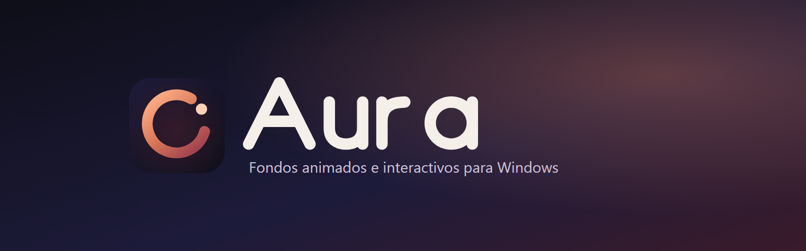
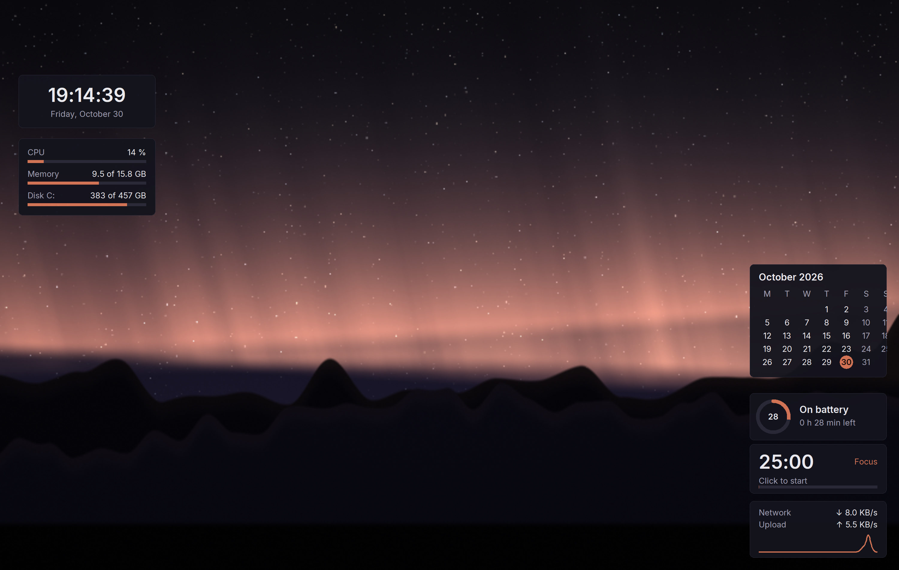
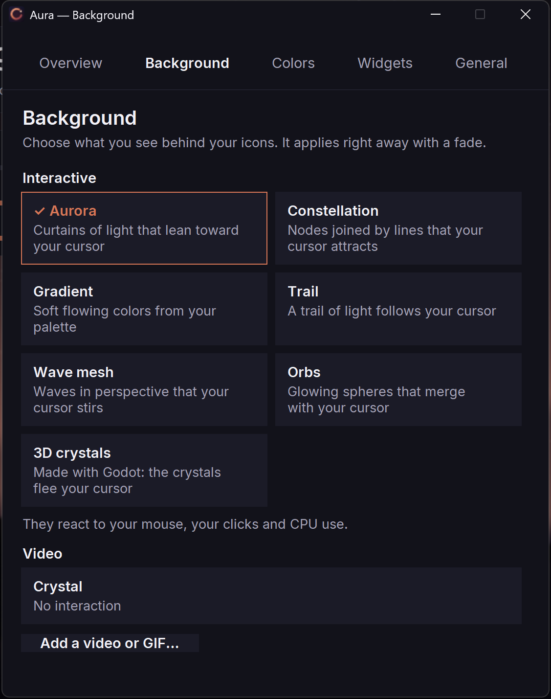
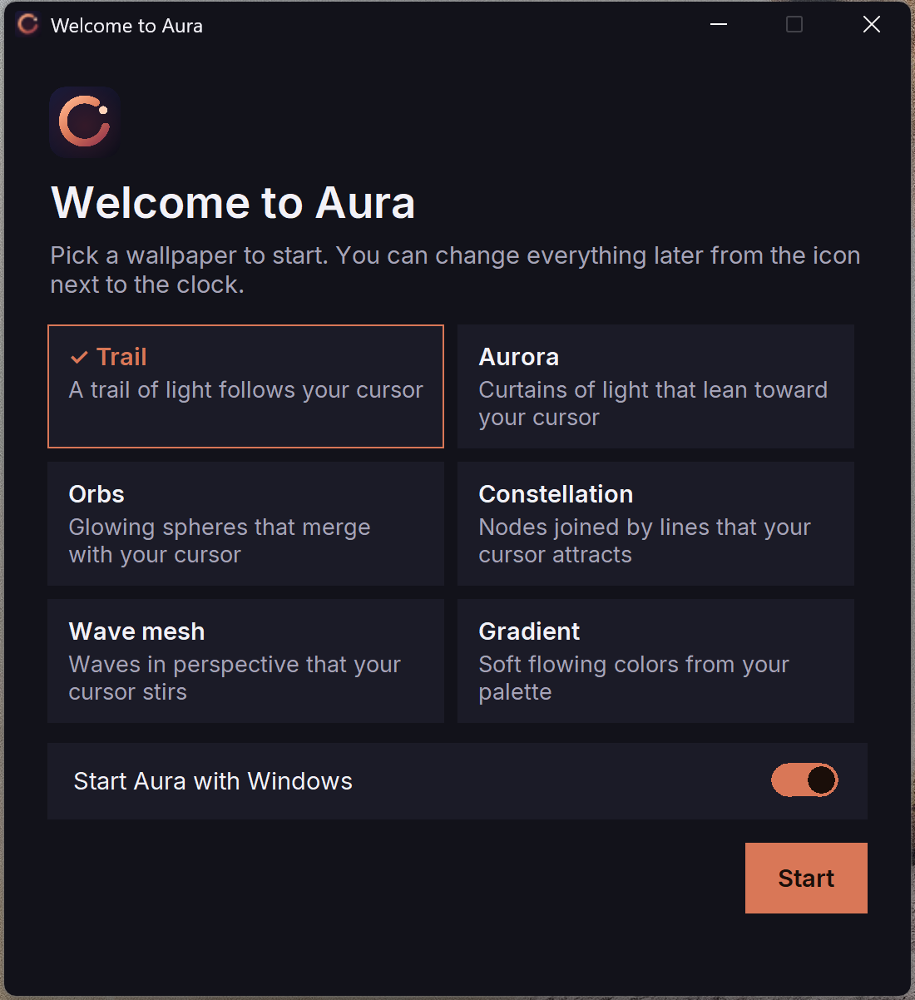
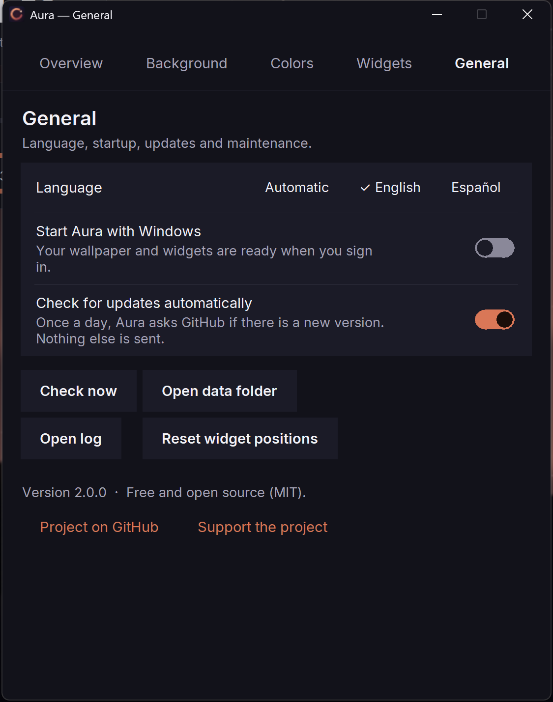

<p align="center"></p>

<p align="center">
  <a href="https://github.com/balmacefa/aura-desktop/actions/workflows/ci.yml"></a>
  <a href="https://github.com/balmacefa/aura-desktop/releases/latest"></a>
  <a href="LICENSE"></a>
  
</p>

<p align="center"><a href="README.md">English</a> · <b>Español</b></p>

# Aura

Aura pone un fondo vivo **detrás de los iconos del escritorio** en Windows 10/11: vídeo animado o escenas interactivas que reaccionan al ratón, a los clics y a la carga del equipo. También añade pequeños widgets de escritorio (reloj, monitor del sistema, calendario, Pomodoro y más). Sin telemetría, sin cuenta, sin anuncios.

| | |
|---|---|
|  |  |
|  |  |

## Instalación (3 pasos, sin conocimientos técnicos)

1. Descarga `Aura-Setup-X.Y.Z.exe` (unos 11,6 MB) de la [última versión](https://github.com/balmacefa/aura-desktop/releases/latest).
2. Haz doble clic. Si Windows muestra una pantalla azul **«Windows protegió su PC»**, pulsa **Más información** y luego **Ejecutar de todas formas**.
3. Abre **Aura** desde el menú Inicio (o su icono de la bandeja) y elige una escena. La primera vez aparece una breve bienvenida.

¿Prefieres no instalar? Descarga el `Aura-portable-X.Y.Z.zip`, descomprímelo donde quieras y ejecuta `Aura.exe`.

**¿Por qué el aviso de SmartScreen?** SmartScreen avisa de cualquier programa nuevo o que no esté firmado con un certificado de pago. Aura es de código abierto y todavía no está firmado, así que Windows aún no lo conoce. Puedes verificar la descarga: cada versión publica `SHA256SUMS.txt`; compáralo con `Get-FileHash Aura-Setup-X.Y.Z.exe` en PowerShell. El código es público en este repositorio.

La instalación es por usuario, no requiere permisos de administrador y se desinstala desde *Configuración > Aplicaciones*. El instalador está en inglés y español. No necesitas tener instalado Python, ffmpeg ni nada más.

## Características
- Fondo dibujado **detrás** de los iconos (funciona en Windows 11 24H2+).
- **Escenas interactivas** que siguen el cursor y reaccionan a clics, carga de CPU, batería y hora del día.
- Tu propio vídeo o GIF como fondo (se reproduce con Edge, sin ffmpeg) y un degradado animado con paleta de 4 colores.
- **Fundidos suaves** entre fondos: nunca se ve el fondo liso de Windows entre medias (respeta el ajuste «Mostrar animaciones» de Windows).
- **Icono de bandeja**: Abrir Aura, Pausar/Reanudar, cambiar fondo, Iniciar con Windows, Buscar actualizaciones, Salir.
- Bienvenida de primer uso y panel de ajustes con 5 pestañas: Resumen, Fondo, Colores, Widgets y General (Ctrl+1 a 5, Esc para cerrar).
- Interfaz en **inglés y español** (sigue el idioma de Windows). Tipografía Inter (SIL OFL) incluida.
- Se pausa solo cuando una ventana tapa el escritorio y con batería baja.
- Configuración validada y escrita de forma atómica; un archivo corrupto se conserva como `aura.json.bad`.
- Diagnóstico integrado: `doctor`.

## Escenas
Escenas web (dibujadas con Microsoft Edge): Estela (`estela`), Constelación (`constelacion`), Orbes (`orbes`), Aurora boreal (`aurora`), Malla de olas (`malla`) y Degradado (nuevo). Tu propio vídeo o GIF también se reproduce con Edge. La escena 3D «Cristales 3D» (`godot-cristal`) solo aparece si Godot 4 está instalado.

## Widgets
Reloj, sistema (CPU / RAM / batería), calendario, batería, Pomodoro, red y un botón de Claude Code (solo si `claude` está instalado). Los widgets dejan de actualizarse mientras el escritorio está tapado.

## Privacidad
- **Sin telemetría.** Aura no envía datos de uso a ningún sitio.
- Las escenas interactivas usan un servidor local que escucha solo en `127.0.0.1` (puerto aleatorio), valida la cabecera `Host` y aplica una CSP estricta (una escena no puede hablar con internet).
- Edge se ejecuta en InPrivate, sin sincronización ni extensiones, con un perfil temporal que se borra al parar.
- La única conexión externa es la comprobación de actualizaciones (ver más abajo). Se puede desactivar en *Ajustes > General*.
- Tus datos están en `%LOCALAPPDATA%\Aura`: `aura.json` (ajustes), `logs\aura.log`, `media\` (tus vídeos) y `updates\`.

## Requisitos
Windows 10 u 11 y Microsoft Edge (viene con Windows; Chrome sirve como alternativa). Nada más: no hace falta Python ni ffmpeg. Opcional: Godot 4 para la escena 3D (software de terceros, no se incluye).

## Actualizaciones automáticas
Una vez al día Aura hace una consulta anónima a la API de GitHub Releases. Si hay una versión nueva, solo la descarga cuando pulsas **Actualizar**. El instalador debe llamarse exactamente `Aura-Setup-X.Y.Z.exe`, llegar por HTTPS desde `github.com` y coincidir con su SHA-256 de `SHA256SUMS.txt`; si no, se descarta. Puedes desactivarlo en *Ajustes > General*.

## Línea de comandos
```
Aura.exe doctor | status | scenes | scene <nombre> | video <archivo>
Aura.exe palette c0 c1 c2 c3 | config | update | quit | logs | version
```
Desde el código: `python -m aura <comando>` (con `src` en el `PYTHONPATH`, o tras `pip install -e .`).

## Rendimiento
Medido en Windows 11, i5-1135G7, 3000x2000 al 200 %, fondo interactivo en reposo (detalles en [docs/RENDIMIENTO.md](docs/RENDIMIENTO.md)):

| Métrica | Antes | Después |
|---|---|---|
| Coste en reposo (widgets + panel + escena, % de un núcleo) | 126,5 | **21,3** |
| Con una ventana encima | 126,9 | **0,3** |
| Memoria de la escena (Edge) | ~1.108 MB | ~556 MB |
| Peticiones por segundo al puente | 62 | 9 |

60 fps con actividad, 30 fps en reposo. El ruido de medición es de unos +/-3 puntos de núcleo. Límite conocido: la pausa solo se activa cuando una única ventana cubre todo el área de trabajo.

## Contribuir
Se agradecen informes de fallos, escenas y pull requests. Lee [CONTRIBUTING.md](CONTRIBUTING.md), el [Código de conducta](CODE_OF_CONDUCT.md) y la [hoja de ruta](ROADMAP.md). Problemas de seguridad: [SECURITY.md](SECURITY.md).

## Apoyar el proyecto
Si Aura te resulta útil, puedes patrocinar su mantenimiento en [GitHub Sponsors](https://github.com/sponsors/balmacefa). El plan está en [docs/MONETIZATION.md](docs/MONETIZATION.md). El núcleo seguirá siendo libre y de código abierto.

## Avisos de terceros
Godot y Microsoft Edge no se incluyen; tienen sus propias licencias y sus marcas pertenecen a sus titulares. La tipografía Inter se incluye bajo la licencia SIL Open Font License.

## Licencia
[MIT](LICENSE).
