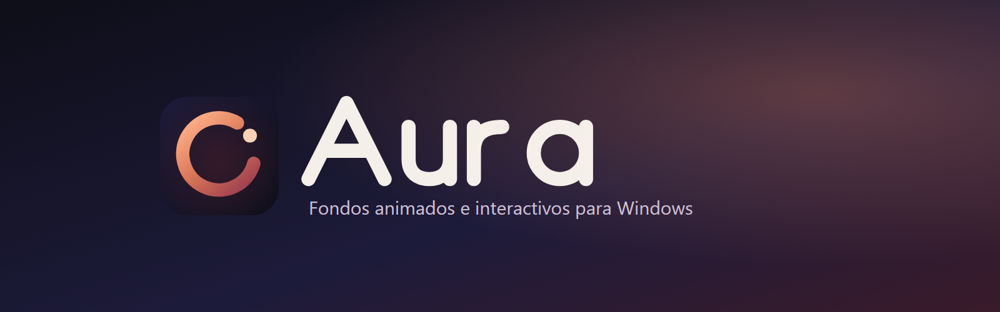
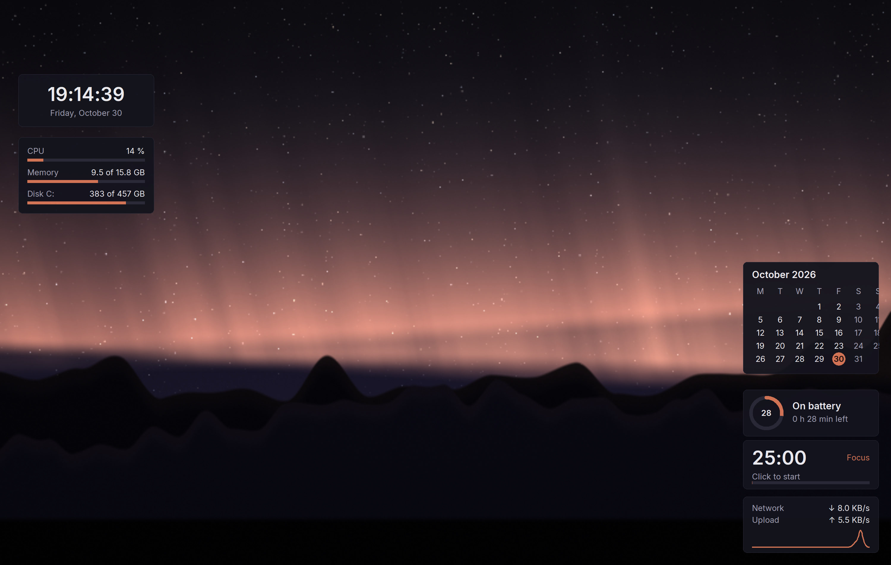
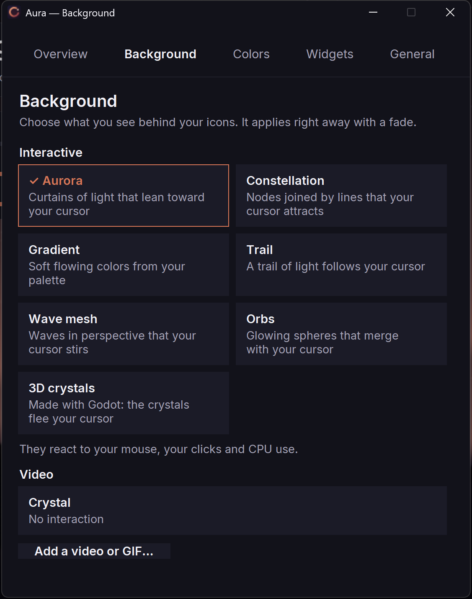
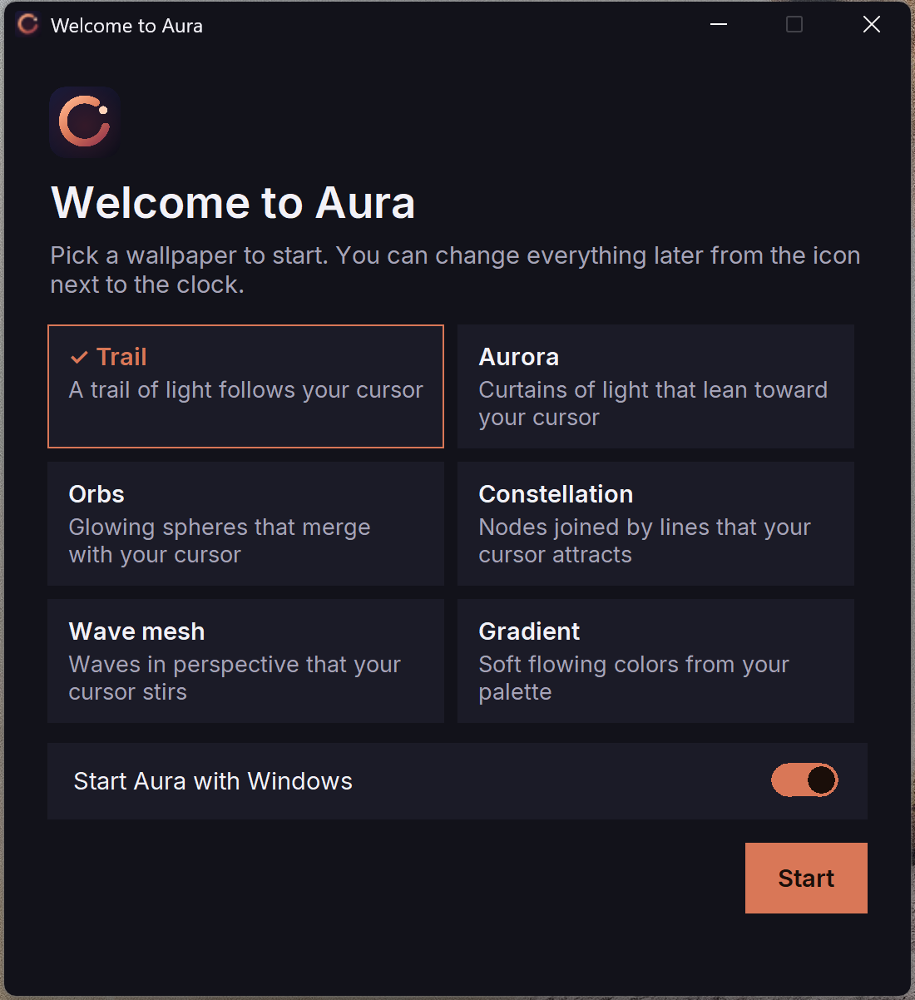
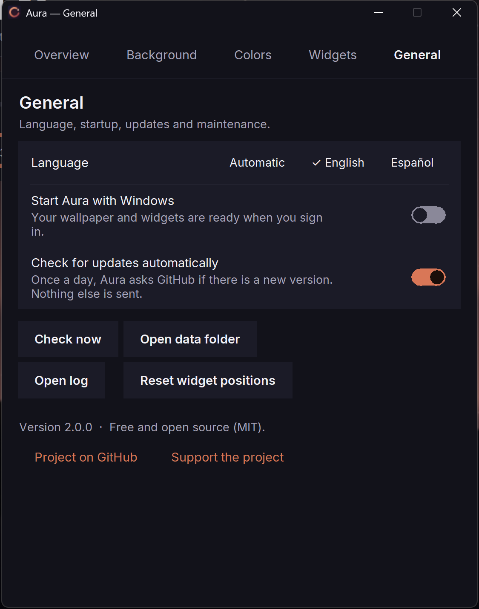

<p align="center"></p>

<p align="center">
  <a href="https://github.com/balmacefa/aura-desktop/actions/workflows/ci.yml"></a>
  <a href="https://github.com/balmacefa/aura-desktop/releases/latest"></a>
  <a href="LICENSE"></a>
  
</p>

<p align="center"><b>English</b> · <a href="README.es.md">Español</a></p>

# Aura

Aura puts a living wallpaper **behind your desktop icons** on Windows 10/11: animated video or interactive scenes that react to your mouse, your clicks and your computer's load. It also adds small desktop widgets (clock, system monitor, calendar, Pomodoro and more). No telemetry, no account, no ads.

| | |
|---|---|
|  |  |
|  |  |

## Install (3 steps, no technical knowledge needed)

1. Download `Aura-Setup-X.Y.Z.exe` (about 11.6 MB) from the [latest release](https://github.com/balmacefa/aura-desktop/releases/latest).
2. Double-click it. If Windows shows a blue **"Windows protected your PC"** screen, click **More info**, then **Run anyway**.
3. Open **Aura** from the Start menu (or its tray icon) and pick a scene. A short welcome appears the first time.

Prefer no installer? Download the portable `Aura-portable-X.Y.Z.zip`, unzip it anywhere and run `Aura.exe`.

**Why the SmartScreen warning?** SmartScreen warns about any program that is new or not signed with a paid code-signing certificate. Aura is open source and not yet signed, so Windows does not know it yet. You can verify your download: each release publishes `SHA256SUMS.txt`; compare it with `Get-FileHash Aura-Setup-X.Y.Z.exe` in PowerShell. The code is public in this repository.

Installation is per user, needs no administrator rights, and uninstalls from *Settings > Apps*. The installer is available in English and Spanish. You do not need Python, ffmpeg or anything else installed.

## Features
- Wallpaper rendered **behind** the icons (works on Windows 11 24H2+).
- **Interactive scenes** that follow the cursor and react to clicks, CPU load, battery and time of day.
- Your own video or GIF as wallpaper (played through Edge, no ffmpeg needed) and an animated gradient with a 4-colour palette.
- **Smooth crossfades** between wallpapers: you never see the plain Windows wallpaper in between (respects the "Show animations" Windows setting).
- **Tray icon**: Open Aura, Pause/Resume, change wallpaper, Start with Windows, Check for updates, Quit.
- First-run welcome and a settings panel with 5 tabs: Summary, Background, Colours, Widgets and General (Ctrl+1 to 5, Esc to close).
- Interface in **English and Spanish** (follows the Windows language). Bundled Inter typeface (SIL OFL).
- Pauses itself when a window covers the desktop, and on low battery.
- Validated, atomically written configuration; a corrupt file is kept as `aura.json.bad`.
- Built-in diagnostics: `doctor`.

## Scenes
Web scenes (rendered with Microsoft Edge): Trail (`estela`), Constellation (`constelacion`), Orbs (`orbes`), Aurora, Wave mesh (`malla`) and Gradient (new). Your own video or GIF also runs through Edge. The 3D scene "3D Crystals" (`godot-cristal`) appears only if Godot 4 is installed.

## Widgets
Clock, system (CPU / RAM / battery), calendar, battery, Pomodoro, network, and a Claude Code button (only shown if `claude` is installed). Widgets stop updating while the desktop is covered.

## Privacy
- **No telemetry.** Aura sends no usage data anywhere.
- Interactive scenes use a local server listening only on `127.0.0.1` (random port), which validates the `Host` header and applies a strict CSP (a scene cannot talk to the internet).
- Edge runs InPrivate, without sync or extensions, using a temporary profile deleted on stop.
- The only external connection is the update check (see below). It can be turned off in *Settings > General*.
- Your data lives in `%LOCALAPPDATA%\Aura`: `aura.json` (settings), `logs\aura.log`, `media\` (your own videos) and `updates\`.

## Requirements
Windows 10 or 11 and Microsoft Edge (included with Windows; Chrome works as an alternative). Nothing else: Python and ffmpeg are not needed. Optional: Godot 4 for the 3D scene (third-party software, not bundled).

## Automatic updates
Once a day Aura makes one anonymous request to the GitHub Releases API. If a newer version exists it only downloads it when you click **Update**. The installer must be named exactly `Aura-Setup-X.Y.Z.exe`, come over HTTPS from `github.com`, and match its SHA-256 in `SHA256SUMS.txt`; otherwise it is discarded. You can disable the check in *Settings > General*.

## Command line
```
Aura.exe doctor | status | scenes | scene <name> | video <file>
Aura.exe palette c0 c1 c2 c3 | config | update | quit | logs | version
```
From source: `python -m aura <command>` (with `src` on `PYTHONPATH`, or after `pip install -e .`).

## Performance
Measured on Windows 11, i5-1135G7, 3000x2000 at 200 %, interactive wallpaper idle (details in [docs/RENDIMIENTO.md](docs/RENDIMIENTO.md)):

| Metric | Before | After |
|---|---|---|
| Idle cost (widgets + panel + scene, % of one core) | 126.5 | **21.3** |
| With a window on top | 126.9 | **0.3** |
| Scene memory (Edge) | ~1,108 MB | ~556 MB |
| Bridge requests per second | 62 | 9 |

60 fps while you interact, 30 fps when idle. Measurement noise is about +/-3 core points. Known limit: pausing only happens when a single window covers the whole work area.

## Contributing
Bug reports, scenes and pull requests are welcome. Read [CONTRIBUTING.md](CONTRIBUTING.md), the [Code of Conduct](CODE_OF_CONDUCT.md) and the [roadmap](ROADMAP.md). Security issues: [SECURITY.md](SECURITY.md).

## Support the project
If Aura is useful to you, you can sponsor its maintenance through [GitHub Sponsors](https://github.com/sponsors/balmacefa). The plan is in [docs/MONETIZATION.md](docs/MONETIZATION.md). The core stays free and open source.

## Third-party notices
Godot and Microsoft Edge are not included; they have their own licences and their trademarks belong to their owners. The Inter typeface is bundled under the SIL Open Font License.

## License
[MIT](LICENSE).
